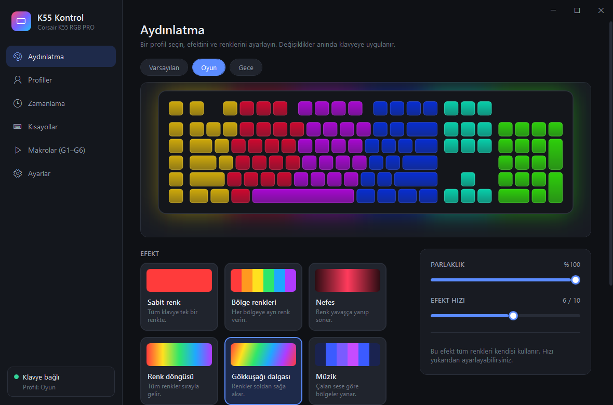

# K55 Kontrol

**Corsair K55 RGB PRO** klavye için iCUE gerektirmeyen, hafif ve tamamen Türkçe aydınlatma ve makro uygulaması.

- Yaklaşık 200 KB, kurulum gerektirmez (iCUE yaklaşık 800 MB)
- Windows'ta hazır gelen .NET Framework 4.8 ile çalışır
- Telemetri, hesap, internet bağlantısı yok

> Bu proje Corsair ile bağlantılı değildir ve Corsair tarafından desteklenmez. "Corsair", "K55" ve "iCUE"
> Corsair Gaming, Inc.'in markalarıdır; burada yalnızca uyumlu donanımı belirtmek için kullanılır.

## İndirme ve kullanım

1. [Releases](../../releases) sayfasından son sürümün `K55Kontrol.zip` dosyasını indirin ve bir klasöre çıkarın.
2. `K55Kontrol.exe`'yi çalıştırın. İmzasız bir program olduğu için Windows SmartScreen uyarı gösterebilir:
   **Ek bilgi → Yine de çalıştır**.
3. **iCUE'yu kapatın.** İkisi aynı anda çalışırsa ikisi de klavyeye yazar ve renkler çakışır. Uygulama iCUE'yu fark
   edip kapatma düğmesi gösterir; kalıcı olarak kapatmak için Görev Yöneticisi → Başlangıç sekmesini kullanın.
4. İsterseniz Ayarlar'dan "Windows açılınca başlat"ı açın; uygulama sistem tepsisinde sessizce başlar.

Desteklenen cihaz: Corsair K55 RGB PRO (USB `1B1C:1BA4`, 5 aydınlatma bölgesi ve Windows kilidi göstergesi). Başka modeller desteklenmez.

## Özellikler

**Aydınlatma**
- Klavyenin canlı önizlemesi (gerçek klavyeyle eş zamanlı), renk seçici, parlaklık ve hız ayarı
- Efektler: Sabit renk, Bölge renkleri, Nefes, Renk döngüsü, Gökkuşağı dalgası, Kapalı, Klavyenin kendi modu
- Veriye dayalı efektler (yalnızca seçiliyken çalışır):
  - **Müzik:** hoparlöre giden ses (mikrofon değil) 5 frekans bandına ayrılır, bas soldan tiz sağdan
  - **Ekran rengi:** ana ekranın 5 dikey şeridinin rengi klavyede aynı konumdaki bölgeye yansır
  - **Tuşa tepki:** basılan tuşun bölgesi parlar (yalnızca tuşun konumu kullanılır, hiçbir şey kaydedilmez)
  - **Sistem göstergesi:** CPU/RAM kullanımı, NVIDIA GPU sıcaklığı ya da HWiNFO sıcaklıkları yeşilden kırmızıya çubuk olarak
- Profil ve efekt değişimlerinde yumuşak geçiş
- **Klavye hafızası:** seçili profil (ya da elle ayarlanan bir efekt) klavyenin kendi hafızasına yazılır;
  K55 Kontrol kapalıyken, oturum açılmadan önce ya da başka bir bilgisayarda da bu aydınlatma görünür.
  Hafızada saklanabilen efektler: sabit renk, gökkuşağı dalgası, renk kayması, renk nabzı, renk dalgası,
  vizör, tuşa tepki, suluboya

**Profiller ve otomasyon**
- Profil oluşturma, adlandırma, çoğaltma, silme
- Programa göre otomatik profil: profile bağlı bir program açılınca o profil devreye girer, kapanınca geri dönülür
- Zamanlanmış profiller (ör. 22:00–07:00 arası "Gece"). Öncelik: açık program > zamanlama > elle seçim
- Işıkları otomatik kapatma: ekran kilitlenince, monitör kapanınca, belirli süre boşta kalınca

**Tuşlar**
- **G1–G6 makro tuşları:** tuş kombinasyonu, metin yazma, program/web sitesi açma, medya kontrolü,
  K55 Kontrol eylemi (profil değiştirme vb.) ya da zamanlamasıyla kaydedilmiş makro atanabilir.
  Atamalar geneldir; istenen profilde istenen tuşa özel bir atama yapılabilir (ör. "Oyun" profilinde G1 başka iş yapar)
- Genel kısayollar (varsayılan Ctrl+Alt+→/←/K/↑/↓/E) ve ekranın altında kısa bildirim; tuşlar değiştirilebilir
- Sistem tepsisi menüsü (profil seçimi, ışıkları aç/kapat)

Ayarlar `%APPDATA%\K55Kontrol\ayarlar.json` dosyasında tutulur. Uygulamadan çıkınca klavye kendi (donanım) moduna,
yani hafızasına yazılmış aydınlatmaya döner.

## Bilinen sınırlamalar
- G tuşları ve veriye dayalı efektler yalnızca K55 Kontrol açıkken çalışır.
- Yönetici olarak çalışan programlara G tuşlarıyla tuş gönderilemez (Windows kısıtlaması).
- Windows tuşu kilidi ve parlaklık tuşu klavyenin kendisinde çalışır; bilgisayara bilgi göndermedikleri için
  uygulamada ayarları yoktur.
- Ekran rengi efekti, tam ekran (exclusive) çalışan bazı oyunlarda siyah kalabilir.
- İşlemci sıcaklığı yalnızca HWiNFO "Shared Memory Support" açıkken okunabilir.
- K55 RGB PRO'da tuş bazında RGB yoktur; aydınlatma 5 bölgeliktir.

## Derleme

Visual Studio 2019 ya da 2022 derleme araçları (MSBuild) gerekir; .NET Framework 4.8 hedefleme paketi gerekmez.

    derle.cmd

Çıktılar `bin\` klasörüne yazılır:
- `K55Kontrol.exe`: uygulama
- `ProtokolTesti.exe`: bölgeleri sırayla yakıp klavye protokolünü dener
- `KaynakTesti.exe`: efekt veri kaynaklarını (ses, ekran, CPU/RAM/GPU) klavyeye dokunmadan dener
- `TusGozlemi.exe [saniye] [dosya]`: klavyenin ham HID raporlarını ve tuş basışlarını kaydeder
- `IsikTesti.exe [saniye]`: 6 ışığın her birini ayrı renkte yakar (ışıkların konumunu bulmak için)
- `HafizaTesti.exe [RRGGBB]`: klavye hafızasına sabit bir renk yazar ve klavyeyi kendi moduna geçirir

Uygulama simgesi `araclar\simge-olustur.ps1` ile üretilir (`assets\K55Kontrol.ico`).

### Klasörler
- `src\` cihaz protokolü, efekt motoru ve veri kaynakları, ayarlar, makrolar
- `ui\` WPF arayüzü (tema, ana pencere ve sayfaları, klavye önizlemesi, renk seçici, bildirim)
- `test\` test ve gözlem araçları

## Protokol notları
- Aydınlatma: arayüz MI_01, usage page 0xFF42, 65 baytlık raporlar. Yazılım modu (`08 01 03 00 02`),
  işlem başlat (`08 0D 00 <uç nokta>`), blok yazma (`08 06 …` / `08 07 …`), düzlemsel R/G/B verisi (6 ışık),
  işlem bitir (`08 05 01 00`). Uygulama `0x01` aydınlatma uç noktasını kullanır. Cevaplarda `[2]` komut yankısı,
  `[3]` durumdur (0 = başarılı). 0 numaralı ışık Windows kilidi / makro kaydı göstergesidir, 1–5 tuş bölgeleridir.
- Klavye hafızası: yazılım modundayken `0x6D61` dosyası açılır (`08 0D 01 61 6D`), temizlenir (`08 09 01`),
  yazılır (`08 06 01 <uzunluk> …`) ve kapatılır (`08 05 01 01`). Veri: `[efekt kodu, 2 bayt LE] [renk türü] [hız]
  [yön] [00] [renk sayısı] [parlaklık, B, G, R]… [ışık sayısı] [ışık listesi]`. Ayrıntılar `src\DonanimAydinlatmasi.cs` içinde.
- G tuşları Windows'a tuş basışı göndermez. Klavyenin MI_02 arayüzünden (usage page 0xFF42, usage 2) gelen
  raporlarda (`rapor[2] = 0x02`) basılı tuş bit haritası bulunur: G1–G5 = `rapor[19]` bitleri 0x08–0x80,
  G6 = `rapor[20]` biti 0x01.

## Teşekkür
Aydınlatma protokolünün yapısı [OpenRGB](https://gitlab.com/CalcProgrammer1/OpenRGB) projesinin
belgelediği "Corsair V2" protokolünden öğrenildi; bu projedeki kod ise sıfırdan yazılmıştır.
G tuşu raporları gerçek cihaz üzerinde gözlemlenerek çözüldü.

## Lisans
[MIT](LICENSE)
